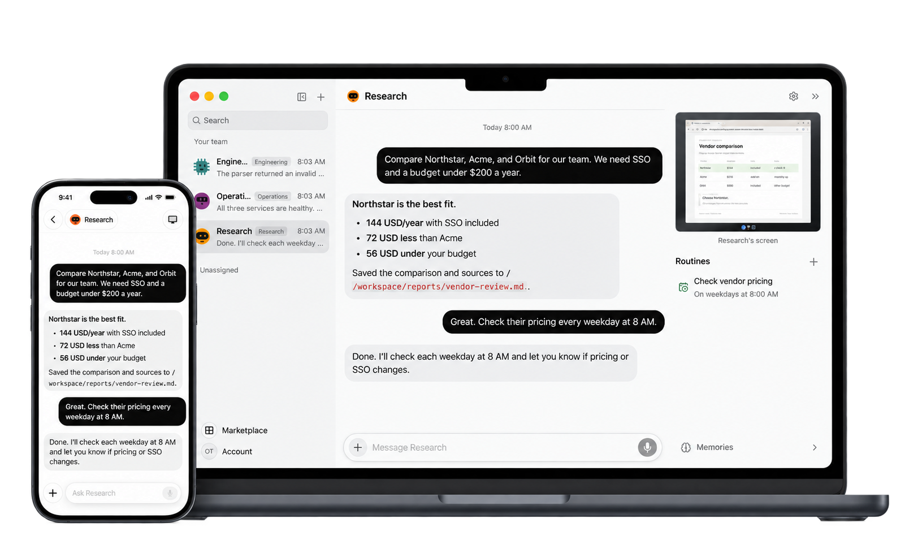

# OpenTeam

**Self-hosted AI agents that keep working on your own hardware.**

Chat with bots that can browse the web, use a Linux desktop, and work with your files.
Each bot keeps its conversation, memory, and browser logins between tasks. Watch its screen,
take over when needed, or come back when the work is done.

[Website](https://openteam.so) · [Get started](#get-started) · [Download apps](#apps) · [Documentation](https://openteam.so/docs) ·
[Develop from source](https://openteam.so/docs/development/from-source)

[](docs/images/openteam-desktop-mobile.png)

## What you can do

- **Give bots a computer.** Each bot has its own screen and browser. All bots share a workspace
  and website sign-ins, so they can build on each other's files and you only sign in once.
- **Keep context.** Conversations resume after restarts. Bots remember what they learn about
  themselves and you across conversations.
- **Work as a team.** Bring multiple bots into a group chat, let them message each other, or delegate
  tasks to subagents.
- **Automate recurring work.** Save instructions as routines that run on a schedule or respond
  to configured events.
- **Connect your tools.** Add skills and plugins for services such as Gmail, GitHub, Slack, and
  Notion, or connect a custom MCP server. Connected accounts are available to every bot.

## Get started

You need an **x64 or arm64 machine** with a running **Docker Engine for Linux containers** and
**Docker Compose 2.20+**. We recommend **8 GB RAM** and **8 GB free disk**. On macOS and Windows,
Docker Desktop supplies the engine and Compose. See the [requirements](https://openteam.so/docs/getting-started/installation#requirements).

### 1. Install the server

Run this on the machine that will host your bots.

**macOS / Linux**

```sh
curl -fsSL https://openteam.so/install | sh
```

**Windows PowerShell**

```powershell
irm https://openteam.so/install.ps1 | iex
```

The installer downloads the CLI, adds it to your `PATH`, and starts guided setup. Node.js and Bun are not required.

### 2. Finish setup

Choose how you'll connect, then create your OpenTeam username and password. Setup defaults to a
private connection over your LAN or VPN, starts the server, and prints your **server URL**.
Setup includes private Tailscale HTTPS, public HTTPS, and existing proxy options. Use `openteam setup --advanced` for additional server settings.

### 3. Open the app

[Download the desktop app](https://openteam.so/download), enter the server URL from setup,
and sign in with the account you just created. The app then helps you connect a model with a
ChatGPT or Claude sign-in, or an OpenAI, Anthropic, or OpenRouter API key, and checks that it
replies. Then create your first bot and send it a task. To use your own model server, add it on
the host with `openteam provider add`; see [model providers](https://openteam.so/docs/configuration/models#use-your-own-model-server).

The host and Docker must stay running for bots and routines to work. Server-side work continues
when you close the app. Keep the desktop app open when bots need access to your physical computer.

## Apps

| App | Get it |
| --- | --- |
| Desktop for macOS (Apple silicon) and Linux (x64) | [Downloads](https://openteam.so/download) |
| iPhone (beta) | [TestFlight](https://testflight.apple.com/join/KFBFPkjP) · [build from source](apps/ios/README.md) |

Both apps connect to your server for chat and live screens. Most server settings, such as the model, are in the desktop app.

## Useful commands

```sh
openteam status    # Check the server and its version
openteam doctor    # Diagnose setup or connection problems
openteam setup     # Change the connection mode
openteam update    # Update the CLI and server with backup and rollback
```

See [server commands](https://openteam.so/docs/manage/server), [remote access](https://openteam.so/docs/configuration/remote-access),
[backups](https://openteam.so/docs/manage/backups), and [troubleshooting](https://openteam.so/docs/manage/troubleshooting) for ongoing operation.

## Documentation

- [Server settings](https://openteam.so/docs/configuration/server): where to change each setting after setup.
- [Plugins](https://openteam.so/docs/usage/plugins): connect accounts and control bot access.
- [How hosting works](https://openteam.so/docs/overview/architecture): what runs where and what needs to stay on.
- [Development from source](https://openteam.so/docs/development/from-source): run from source and run checks.

Browse [all documentation](https://openteam.so/docs) for feature guides and implementation notes.

## License

OpenTeam is licensed under the [GNU General Public License v3.0](LICENSE). Some bundled
third-party components, such as noVNC, fonts, and a few plugins, keep their own licenses, which
are included alongside them.
